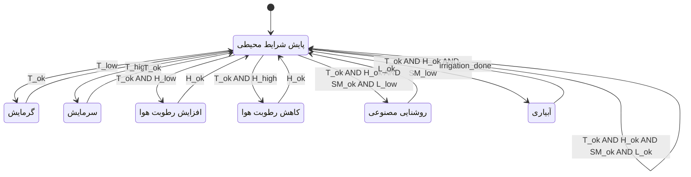

# تمرین جلسهٔ اول: مدل‌سازی سیستم گسسته و ماشین حالت متناهی

**پروژه:** سیستم کنترل اقلیم گلخانه هوشمند (Greenhouse Climate Controller)  
**مبحث:** سیستم‌های گسسته (Discrete Systems) و ماشین حالت متناهی (Finite-State Machine — FSM)  
**منبع درسی:** فصل ۳، بخش‌های ۳.۱ تا ۳.۳ کتاب *Introduction to Embedded Systems: A Cyber-Physical Systems Approach*

## ۱. هدف تمرین

هدف این تمرین، ارائهٔ یک مدل اولیه از رفتار سیستم کنترل اقلیم گلخانه با استفاده از ماشین حالت متناهی است. در این مدل، کنترل‌کننده داده‌های گسسته‌شدهٔ حسگرها را بررسی می‌کند و بر اساس وضعیت محیط، به یکی از حالت‌های عملیاتی می‌رود.

## ۲. تعریف سیستم گسسته

**سیستم گسسته (Discrete System)** سیستمی است که وضعیت یا رفتار مدل‌شدهٔ آن در گام‌ها یا لحظه‌های مشخص به‌روزرسانی می‌شود. در این پروژه، کنترل‌کننده در هر نوبت نمونه‌برداری، وضعیت حسگرها را می‌خواند، حالت فعلی را بررسی می‌کند و در صورت برقرار بودن شرط یک انتقال، حالت بعدی و خروجی‌های متناظر را تعیین می‌کند.

در مدل جلسهٔ اول، اندازه‌گیری‌های فیزیکی به‌جای استفاده از مقدارهای پیوستهٔ عددی، به دسته‌های گسسته مانند «کم»، «مناسب» و «زیاد» تبدیل می‌شوند. تعیین عددی آستانه‌ها و اضافه‌کردن هیسترزیس به مراحل بعد واگذار می‌شود.

## ۳. ورودی‌های سیستم (Inputs)

| نماد | معنی |
|---|---|
| `T_low` | دمای هوا پایین‌تر از محدودهٔ مطلوب است. |
| `T_high` | دمای هوا بالاتر از محدودهٔ مطلوب است. |
| `T_ok` | دمای هوا در محدودهٔ مناسب قرار دارد. |
| `H_low` | رطوبت نسبی هوا کمتر از محدودهٔ مطلوب است. |
| `H_high` | رطوبت نسبی هوا بیشتر از محدودهٔ مطلوب است. |
| `H_ok` | رطوبت نسبی هوا در محدودهٔ مناسب است. |
| `SM_low` | رطوبت خاک کمتر از مقدار مطلوب است. |
| `SM_ok` | رطوبت خاک برای این مدل مناسب است. |
| `L_low` | شدت نور برای رشد گیاه کافی نیست. |
| `L_ok` | شدت نور کافی است. |
| `irrigation_done` | عملیات آبیاری پایان یافته است. در این مدل، این مورد یک رخداد ورودی در نظر گرفته می‌شود؛ رفتار زمان‌سنج در جلسهٔ دوم مدل خواهد شد. |

**فرض ورودی‌ها:** در هر نوبت، برای دما یکی از `T_low`، `T_ok` یا `T_high` برقرار است؛ برای رطوبت هوا نیز یکی از `H_low`، `H_ok` یا `H_high` برقرار است. همچنین در این مدل ساده، وضعیت رطوبت خاک و نور با نمادهای مربوط به خود مشخص می‌شود.

## ۴. خروجی‌های سیستم (Outputs)

| نماد | معنی |
|---|---|
| `heater_on` | فعال بودن سامانهٔ گرمایش |
| `cooler_on` | فعال بودن سامانهٔ سرمایش |
| `humidifier_on` | فعال بودن سامانهٔ افزایش رطوبت هوا |
| `dehumidifier_on` | فعال بودن سامانهٔ کاهش رطوبت هوا یا تهویه |
| `grow_light_on` | فعال بودن روشنایی مصنوعی برای رشد گیاه |
| `irrigation_pump_on` | فعال بودن پمپ آبیاری |

مقدار `1` به معنی روشن یا فعال و مقدار `0` به معنی خاموش یا غیرفعال است.

## ۵. حالت‌های سیستم (States)

| نام حالت | توضیح | خروجی فعال در این حالت |
|---|---|---|
| `Monitoring` | پایش شرایط محیطی و بررسی ورودی‌ها | همهٔ خروجی‌ها خاموش |
| `Heating` | افزایش دمای گلخانه | `heater_on = 1` |
| `Cooling` | کاهش دمای گلخانه | `cooler_on = 1` |
| `Humidifying` | افزایش رطوبت نسبی هوا | `humidifier_on = 1` |
| `Dehumidifying` | کاهش رطوبت نسبی هوا | `dehumidifier_on = 1` |
| `Lighting` | روشن کردن نور مصنوعی | `grow_light_on = 1` |
| `Irrigation` | آبیاری خاک | `irrigation_pump_on = 1` |

در حالت‌های عملیاتی، خروجی مربوط به همان حالت فعال و سایر خروجی‌ها غیرفعال فرض می‌شوند. این فرض برای ساده نگه‌داشتن FSM اولیه است و در مراحل بعدی توسعه بازبینی می‌شود.

## ۶. تعریف رسمی ماشین حالت

برای این تمرین، ماشین حالت را با پنج‌تایی زیر نمایش می‌دهیم:

\[
M = (I, O, S, T, s_0)
\]

- **`I` — مجموعهٔ ورودی‌ها:** `{T_low, T_high, T_ok, H_low, H_high, H_ok, SM_low, SM_ok, L_low, L_ok, irrigation_done}`
- **`O` — مجموعهٔ خروجی‌ها:** `{heater_on, cooler_on, humidifier_on, dehumidifier_on, grow_light_on, irrigation_pump_on}`
- **`S` — مجموعهٔ حالت‌ها:** `{Monitoring, Heating, Cooling, Humidifying, Dehumidifying, Lighting, Irrigation}`
- **`T` — مجموعهٔ انتقال‌ها:** قواعد انتقالی که در نمودار حالت و جدول انتقال بخش‌های بعد مشخص شده‌اند.
- **`s₀` — حالت آغازین:** `Monitoring`

### اولویت تصمیم‌گیری در مدل اولیه

چون FSM جلسهٔ اول تنها یک حالت عملیاتی را در هر لحظه فعال می‌کند، در صورت وجود چند نیاز هم‌زمان از این اولویت استفاده می‌شود:

۱. اصلاح دما؛ ۲. اصلاح رطوبت هوا؛ ۳. آبیاری بر اساس رطوبت خاک؛ ۴. روشنایی مصنوعی.

بنابراین، انتقال به حالت آبیاری فقط وقتی بررسی می‌شود که دما و رطوبت هوا در محدودهٔ مناسب باشند؛ انتقال به روشنایی نیز فقط وقتی بررسی می‌شود که دما، رطوبت هوا و رطوبت خاک در وضعیت مناسب باشند. این اولویت یک فرض مدل‌سازی برای نسخهٔ ساده است، نه الزام یک سامانهٔ واقعی.

## ۷. نمودار ماشین حالت (Mermaid State Diagram)

## ۸. جدول انتقال حالت‌ها (State Transition Table)

| حالت فعلی | ورودی یا شرط | حالت بعدی | خروجی یا اقدام |
|---|---|---|---|
| `Monitoring` | `T_low` | `Heating` | روشن کردن گرمایش |
| `Monitoring` | `T_high` | `Cooling` | روشن کردن سرمایش |
| `Monitoring` | `T_ok AND H_low` | `Humidifying` | روشن کردن سامانهٔ افزایش رطوبت |
| `Monitoring` | `T_ok AND H_high` | `Dehumidifying` | روشن کردن سامانهٔ کاهش رطوبت یا تهویه |
| `Monitoring` | `T_ok AND H_ok AND SM_low` | `Irrigation` | روشن کردن پمپ آبیاری |
| `Monitoring` | `T_ok AND H_ok AND SM_ok AND L_low` | `Lighting` | روشن کردن روشنایی مصنوعی |
| `Monitoring` | `T_ok AND H_ok AND SM_ok AND L_ok` | `Monitoring` | خاموش ماندن همهٔ خروجی‌ها |
| `Heating` | `T_ok` | `Monitoring` | خاموش شدن گرمایش |
| `Cooling` | `T_ok` | `Monitoring` | خاموش شدن سرمایش |
| `Humidifying` | `H_ok` | `Monitoring` | خاموش شدن سامانهٔ افزایش رطوبت |
| `Dehumidifying` | `H_ok` | `Monitoring` | خاموش شدن سامانهٔ کاهش رطوبت |
| `Irrigation` | `irrigation_done` | `Monitoring` | خاموش شدن پمپ آبیاری |
| `Lighting` | `L_ok` | `Monitoring` | خاموش شدن روشنایی مصنوعی |

اگر شرط خروج از یک حالت عملیاتی هنوز برقرار نشده باشد، سیستم در همان حالت می‌ماند و خروجی همان حالت فعال باقی می‌ماند. پس از بازگشت به `Monitoring`، ورودی‌ها دوباره ارزیابی می‌شوند.

## ۹. توضیح عملکرد کلی

۱. سیستم با حالت آغازین `Monitoring` شروع می‌کند.
۲. اگر دما پایین باشد، به `Heating` می‌رود؛ اگر دما بالا باشد، به `Cooling` می‌رود.
۳. اگر دما مناسب باشد، وضعیت رطوبت هوا بررسی می‌شود؛ در صورت کمبود رطوبت به `Humidifying` و در صورت زیادبودن رطوبت به `Dehumidifying` می‌رود.
۴. اگر دما و رطوبت هوا مناسب باشند، رطوبت خاک بررسی می‌شود. در صورت کمبود رطوبت خاک، سیستم وارد حالت `Irrigation` می‌شود.
۵. اگر شرایط قبلی مناسب و نور ناکافی باشد، سیستم وارد حالت `Lighting` می‌شود.
۶. پس از برطرف‌شدن شرط مربوط به هر حالت، یا پایان آبیاری، سیستم به `Monitoring` بازمی‌گردد و شرایط را دوباره بررسی می‌کند.

## ۱۰. محدودیت‌های مدل اولیه و توسعهٔ آینده

- این مدل برای تمرین FSM ساده شده است و چند زیرسامانه را به‌طور هم‌زمان فعال نمی‌کند.
- مقدارهای عددی دما، رطوبت و نور و محدوده‌های دقیق آن‌ها در این جلسه تعریف نشده‌اند.
- برای جلوگیری از روشن و خاموش شدن مکرر تجهیزات، در جلسهٔ دوم بازه‌های هیسترزیس و شرط‌های دقیق‌تری تعریف می‌شوند.
- تایمر آبیاری و متغیرهای حالت در جلسهٔ دوم به مدل افزوده می‌شوند.
- در جلسهٔ سوم، مدل به ماشین‌های حالت مجزا و قابل ترکیب برای کنترل اقلیم و ایمنی تقسیم خواهد شد تا رفتار هم‌زمان بخش‌ها بهتر نشان داده شود.

## ۱۱. منبع

Lee, Edward A., and Sanjit A. Seshia. *Introduction to Embedded Systems: A Cyber-Physical Systems Approach*, Second Edition. The MIT Press, 2016. فصل ۳، بخش‌های ۳.۱ تا ۳.۳.
